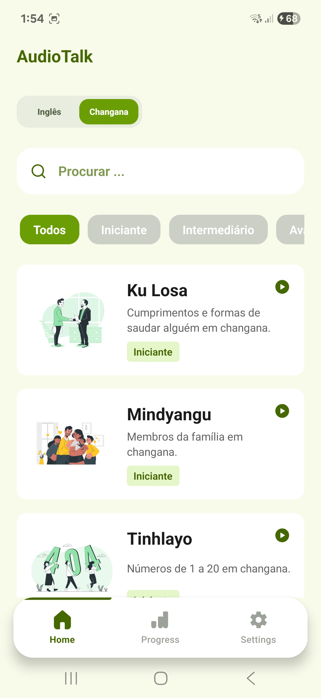
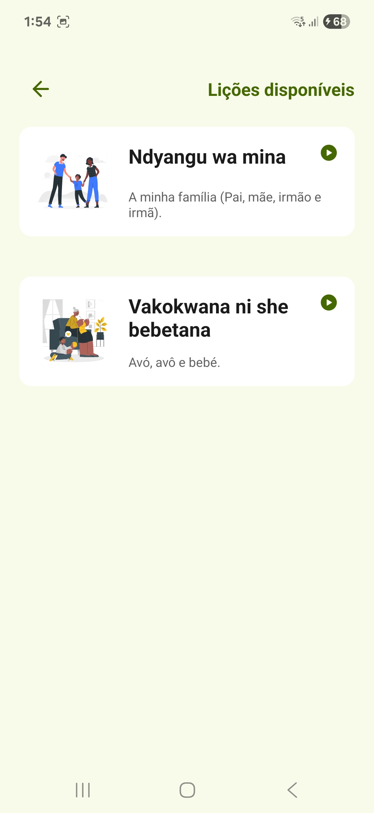
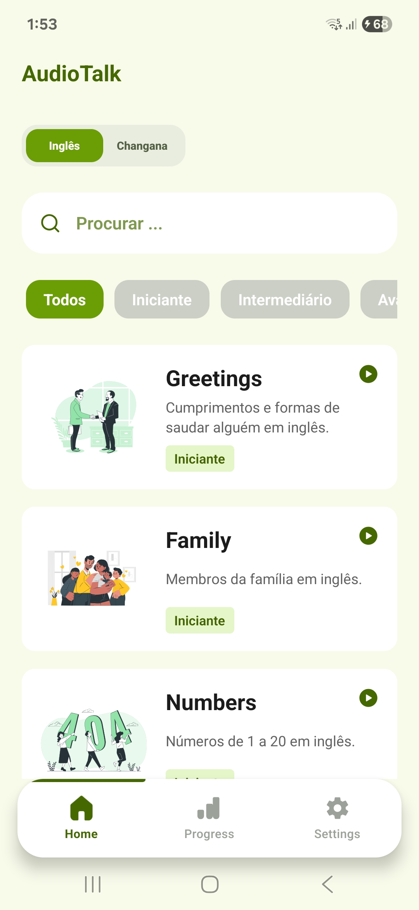
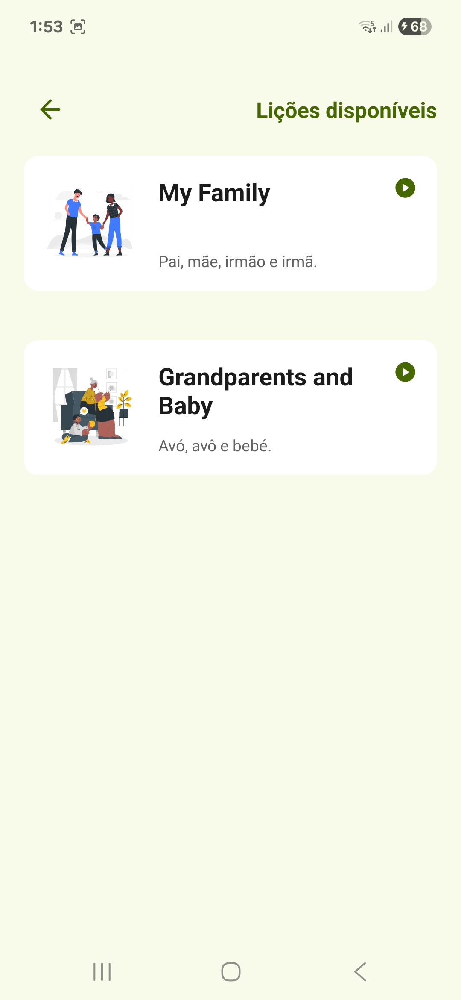
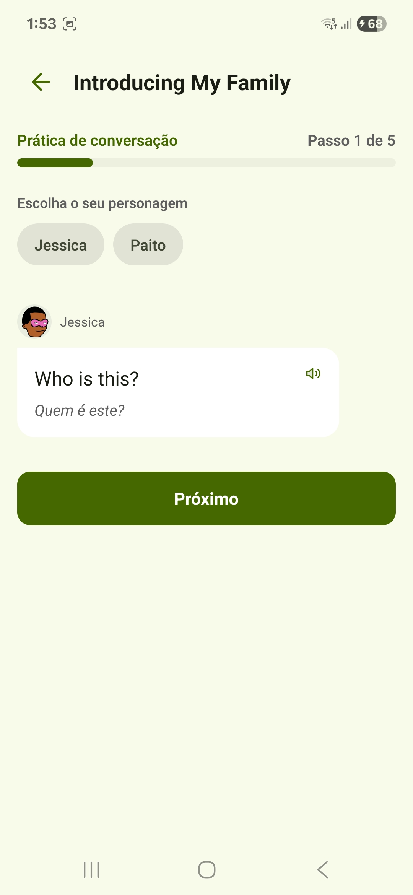
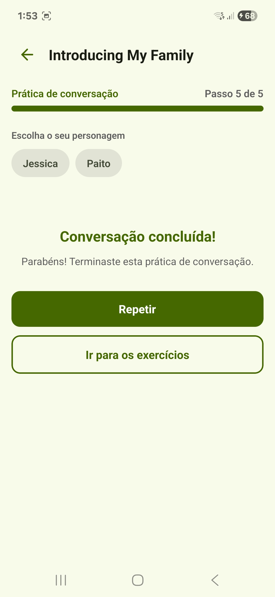

# Aplicação de Aprendizagem de Inglês e Changana

Uma aplicação móvel educativa desenvolvida para apoiar crianças e adolescentes na aprendizagem da língua inglesa e da língua Changana, através de lições, diálogos e exercícios interactivos.

O projecto procura tornar a aprendizagem de línguas mais acessível, prática e atractiva, valorizando simultaneamente a língua local Changana e promovendo o desenvolvimento de competências linguísticas em Inglês.

## 1. Problema que procura resolver

A aprendizagem de línguas estrangeiras e locais pode ser limitada pela falta de ferramentas educativas acessíveis, interactivas e adaptadas à realidade dos estudantes moçambicanos.

No caso do Changana, existe também a necessidade de incentivar a valorização e transmissão das línguas locais às novas gerações.

A aplicação responde a estes desafios através de uma plataforma móvel que permite aprender Inglês e Changana de forma organizada, prática e interactiva.

## 2. Principais funcionalidades

- **Aprendizagem bilingue:** conteúdos educativos em Inglês e Changana, com áudio para ambas as línguas.
- **Lições organizadas:** conteúdos distribuídos por categorias (por exemplo: saudações, família, números, cores, animais e corpo).
- **Diálogos interactivos:** conversações organizadas em linhas para facilitar a compreensão e a prática.
- **Quiz:** exercícios para testar o vocabulário aprendido.
- **Progresso:** acompanhamento da evolução do utilizador.
- **Gravação de áudio:** suporte à gravação de voz para exercícios de prática linguística.
- **Autenticação e onboarding:** ecrãs de início de sessão e de introdução à aplicação.
- **Definições:** personalização da experiência e preferências do utilizador.
- **Armazenamento local:** persistência de conteúdos e dados do utilizador no dispositivo.
- **Experiência intuitiva:** interface concebida para facilitar a utilização por crianças e adolescentes.

## 3. Tecnologias utilizadas

| Tecnologia | Finalidade |
|---|---|
| React Native | Desenvolvimento da aplicação móvel |
| Expo SDK 57 | Ambiente e ferramentas de desenvolvimento |
| TypeScript | Tipagem estática e organização do código |
| Expo Router | Navegação entre ecrãs |
| SQLite (expo-sqlite) | Base de dados local |
| Zustand | Gestão do estado da aplicação |
| MMKV | Armazenamento local de dados e preferências |
| Expo Audio | Funcionalidades de áudio e gravação |
| NativeWind / Tailwind CSS | Estilização da interface |

## 4. Arquitectura do sistema

O projecto está organizado por **funcionalidades** (`features`), com camadas separadas para a interface, o estado, os serviços e a persistência de dados.

```text
Aplicação Mobile
│
├── Interface (UI)
│   ├── Ecrãs e navegação (src/app, Expo Router)
│   ├── Componentes reutilizáveis (src/components)
│   └── Funcionalidades (src/features)
│       ├── auth
│       ├── onboarding
│       ├── splash
│       ├── home
│       ├── lessons
│       ├── dialogues
│       ├── quiz
│       ├── progress
│       └── settings
│
├── Gestão do Estado
│   └── Zustand
│
├── Serviços
│   └── Gravações de áudio (src/services/recordingStorage.ts)
│
└── Persistência Local
    ├── SQLite (src/database)
    │   ├── Languages
    │   ├── Categories
    │   ├── Lessons
    │   ├── Dialogues
    │   ├── Dialogue Lines
    │   └── User Recordings
    │
    └── MMKV (src/lib/storage.tsx)
        └── Preferências e dados locais
```

### Estrutura de pastas

```text
linguas
├── assets                 # Ilustrações (SVG), imagens, ícones e áudio (ch/en)
├── scripts                # Scripts auxiliares (ex.: reset-project.js)
├── src
│   ├── app                # Rotas e ecrãs (Expo Router)
│   │   ├── (app)
│   │   ├── onboarding
│   │   ├── _layout.tsx
│   │   ├── login.tsx
│   │   ├── explore.tsx
│   │   └── splash.tsx
│   ├── components         # Componentes de interface reutilizáveis
│   ├── constants          # Tema e constantes (incluindo áudio)
│   ├── database           # SQLite: ligação, esquema, repositórios e seed
│   │   ├── db.ts
│   │   ├── schema.ts
│   │   ├── repositories
│   │   └── seed
│   ├── features           # Módulos por funcionalidade
│   │   ├── auth
│   │   ├── dialogues
│   │   ├── home
│   │   ├── lessons
│   │   ├── onboarding
│   │   ├── progress
│   │   ├── quiz
│   │   ├── settings
│   │   └── splash
│   ├── hooks              # Hooks personalizados (tema, esquema de cores)
│   ├── lib                # Utilitários, autenticação e armazenamento
│   ├── services           # Serviços (ex.: gestão de gravações)
│   └── global.css         # Estilos globais (Tailwind / NativeWind)
├── app.json               # Configuração do Expo
├── package.json
├── tsconfig.json
└── LICENSE
```

### Modelo de dados

A base de dados SQLite utiliza as seguintes entidades principais:

- `languages`: idiomas disponíveis.
- `categories`: categorias de aprendizagem.
- `lessons`: conteúdos das lições.
- `dialogues`: diálogos educativos.
- `dialogue_lines`: linhas e intervenções dos diálogos.
- `user_recordings`: gravações de áudio dos utilizadores.

Os dados iniciais são carregados a partir da pasta `src/database/seed`.

## 5. Capturas de ecrã e demonstração

### Changana

| | | | | |
|---|---|---|---|---|
|  |  |  |  |  |

### Inglês

| | | | |
|---|---|---|---|
|  |  |  |  |

## 6. Como instalar e executar

### Pré-requisitos

- [Node.js](https://nodejs.org/) (versão LTS recomendada).
- npm (ou pnpm, caso prefira).
- Android Studio (emulador) ou um dispositivo Android com a aplicação **Expo Go**.

### Clonar o repositório

```bash
git clone https://github.com/SEU_UTILIZADOR/NOME_DO_REPOSITORIO.git
```

### Entrar na pasta do projecto

```bash
cd NOME_DO_REPOSITORIO
```

### Instalar as dependências

```bash
npm install
```

### Executar a aplicação

```bash
npx expo start
```

Depois, no terminal:

- prima `a` para abrir no emulador Android; ou
- leia o código QR com o Expo Go no seu telemóvel.

> **Nota:** se o projecto usar módulos nativos que não são suportados pelo Expo Go (como o MMKV), será necessário gerar uma _development build_ com `npx expo run:android`.

## 7. Melhorias futuras

- Mais exercícios interactivos de vocabulário e gramática.
- Mecanismos de avaliação mais detalhados e acompanhamento do progresso.
- Expansão da biblioteca de conteúdos em Inglês e Changana.
- Integração de pronúncia em áudio para todas as palavras e expressões.
- Melhoria dos exercícios de reconhecimento e gravação de voz.
- Sistema de recompensas para incentivar a aprendizagem.
- Expansão do suporte a conteúdos educativos offline.

Desenvolvido com React Native e Expo.